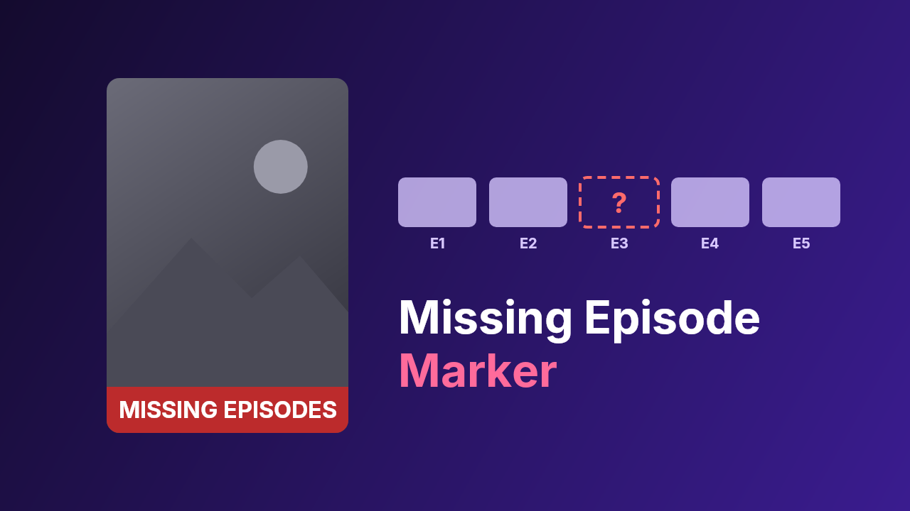
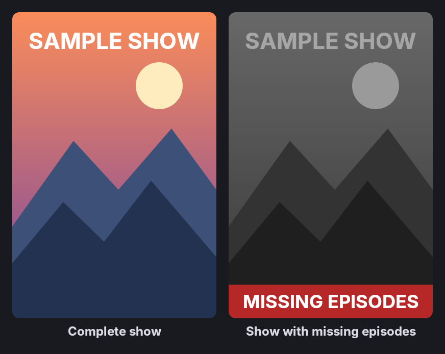
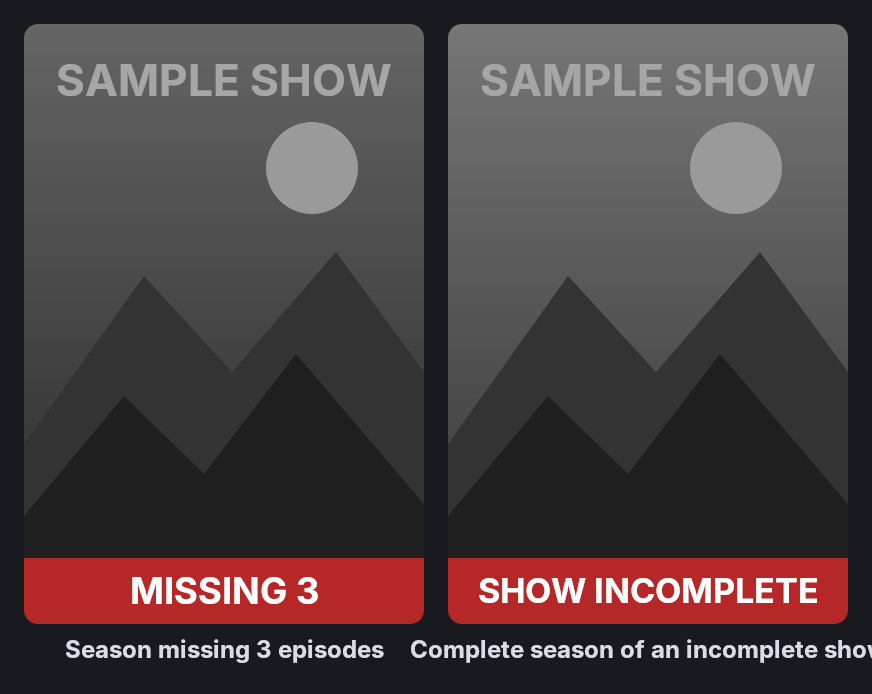

<p align="center">
  
</p>

# Missing Episode Marker

A Jellyfin plugin that marks TV shows and seasons that are missing episodes, so
viewers never skip an episode without knowing it.

It asks **Sonarr** which episodes are missing and draws a marker (a grey filter
and/or a banner) **into the poster image itself**. Because the marker is part of the
image, every app shows it: the web interface, Android and iOS, Samsung/LG TV apps,
Swiftfin, Infuse and so on.

<p align="center">
  
</p>

Requires **Jellyfin 12.x** and **Sonarr v3 or newer**.

## Contents

- [Features](#features)
- [Install](#install)
- [Settings](#settings)
- [How it works](#how-it-works)
- [Troubleshooting](#troubleshooting)
- [Removing the plugin](#removing-the-plugin)
- [Releasing a new version](#releasing-a-new-version-maintainers)

## Features

**Detection**
- **Ended shows** are marked when any monitored episode has no file.
- **Ongoing shows** are marked once a missing episode aired longer ago than a grace
  period you choose (days, weeks, months or years). Gaps in older seasons count too.
- Unaired episodes and episodes without an air date (TBA) never count.
- **Specials (season 0):** ignore them, count them for every show, or only for shows
  you pick. Choose which specials count via Sonarr monitoring, or tick them in a list
  that shows titles and air dates.
- **Anime:** missing filler (and optionally "mixed canon/filler") episodes can be
  ignored. Filler lists come from animefillerlist.com (cached, address configurable)
  or can be typed in by hand per series.
- **Per-series rules:** never mark a show, include or exclude its specials, override
  filler handling. Search for series and give several the same rule at once; shows
  and anime have their own tabs.

**Markers**
- Marks **series posters** and **season posters**. Season banners can show the number
  of missing episodes, e.g. `MISSING {count}` → "MISSING 3".
- Optionally marks **every season of an incomplete show**, so the "Recently added" row
  (which often shows a single season) shows the marker too.
- Grey poster, colour filter with adjustable opacity, and a banner at the **top**,
  **bottom**, **diagonally** or as a **corner ribbon**, in any colour and text.
- Live **preview** on the settings page, drawn on one of your own posters.

<p align="center">
  
</p>

<p align="center">
  
</p>

**Keeps itself up to date**
- When Jellyfin downloads a new show's poster after a scan, or a metadata refresh
  replaces a marked poster, the marker is applied within seconds.
- About 1.5 minutes after episodes are added or removed, that show is rechecked: the
  count updates, and the original poster returns when the show is complete.
- Saving settings that affect detection or appearance starts a new check by itself.
- A full check runs on a schedule you choose (off / hourly / 6 h / 12 h / daily /
  weekly) and optionally after every library scan.

**Poster repair**
- Shows whose poster is missing, or is a frame from the video (wide instead of tall),
  get a fresh poster fetched from Jellyfin's image providers. Only the poster is
  refreshed; each item is tried at most once a week.
- Optional: the same for **movies** (movies are never marked).

**Status & report**
- Progress bar with an estimated time left.
- A report of every incomplete show: which episodes are missing, per season, and
  whether its poster could be marked. Updates itself while open.

**Safe**
- Original poster files are never changed. Jellyfin is pointed at a marked copy, and
  back at the original when the show is complete, when marking is turned off, or when
  the plugin is uninstalled.

## Install

1. Jellyfin → **Dashboard → Plugins → Repositories → +**
2. Name: `Missing Episode Marker`, URL:
   ```
   https://raw.githubusercontent.com/Adam-Tew/jellyfin-plugin-missing-episode-marker/main/manifest.json
   ```
3. **Catalog** → *Missing Episode Marker* → **Install**, then restart Jellyfin.
4. Open **Dashboard → Plugins → Missing Episode Marker**. On the **General** tab,
   enter your Sonarr URL as the *Jellyfin server* reaches it (for example
   `http://sonarr:8989` when both run on the same Docker network) and the API key
   (Sonarr → Settings → General), then click **Save & test connection**.
5. On the **Status & report** tab, click **Run check now**.

**Updating:** when a new version is listed, install it from the catalog (or let
"Update Plugins" do it if automatic updates are on for the plugin), then restart
Jellyfin. The settings page shows the installed version next to its title.

## Settings

| Tab | What you set there |
|---|---|
| **General** | Sonarr connection; full-check schedule; react to library changes; check after library scans; poster repair for shows and movies; dashboard menu entry |
| **Status & report** | Run a check, progress, the incomplete-show report, remove all markers |
| **Detection & appearance** | Grace period; whether ended shows get a grace period; which posters to mark; filter, banner, colours, texts; preview |
| **TV shows** | How specials count; rules for individual shows, including a specials picker |
| **Anime** | Anime on/off; whether missing filler counts; filler list source; rules for individual anime (filler list page, manual filler list) |

Settings with a **?** next to them have an explanation with an example.
Results of a check apply straight away; **Save** is only for settings.

## How it works

1. Sonarr series are matched to Jellyfin series by TVDB id (then IMDb, then TMDB).
   Only series managed by Sonarr are checked.
2. For each series, the plugin decides which missing episodes count (grace period,
   specials, filler, rules).
3. For each incomplete series and season, it draws a marked copy of the poster into
   `<jellyfin data>/missing-episode-marker/posters/` and points Jellyfin at it.
4. It remembers what should be marked, so posters that arrive or change later are
   marked automatically, and it restores the original when a show is complete.

## Troubleshooting

- **The report lists a show but its poster isn't marked:** look at the *Poster*
  column. "No poster yet; marked as soon as one arrives" means Jellyfin hasn't
  downloaded artwork yet; the marker appears when it does.
- **"Recently added" shows an unmarked poster:** that row often shows a single season.
  Turn on *Mark every season of an incomplete show*.
- **Apps still show the old poster:** apps cache images; refresh or reopen the app.
- **Details:** Dashboard → Logs, search for "Missing Episode Marker" or the show's name.

## Removing the plugin

Uninstalling restores the original posters automatically. To be extra safe, click
**Remove all markers** on the Status & report tab first.

## Releasing a new version (maintainers)

1. Bump `version` in `build.yaml` (four numbers, e.g. `0.4.0.0`) and update `changelog`.
2. On GitHub: **Releases → Draft a new release**, create the tag `v0.4.0.0`
   (same number with a `v`) and click **Publish release**.
3. The **Release** workflow builds the plugin, attaches the zip to the release and
   adds the version to `manifest.json`. Jellyfin then offers the update.

## License

GPL-3.0. Not affiliated with Jellyfin, Sonarr or animefillerlist.com.
The example images use made-up artwork.
