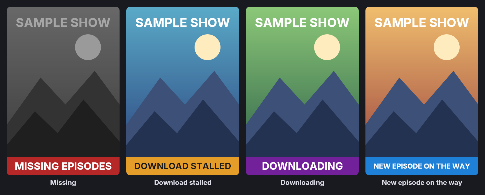
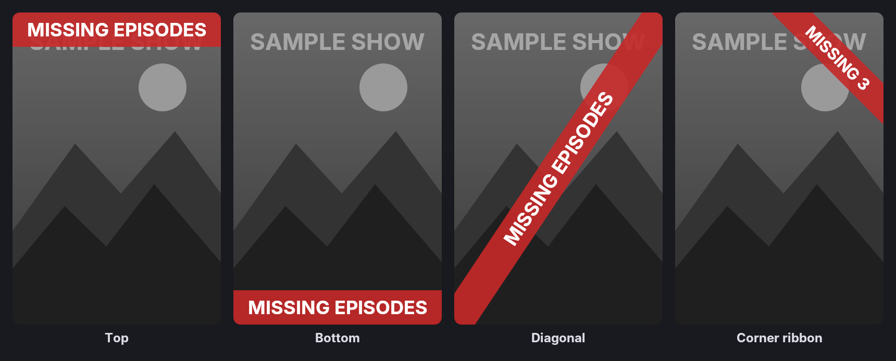

<p align="center">
  
</p>

# Missing Episode Marker

A Jellyfin plugin that shows on the poster what **Sonarr** is doing with a show:
episodes are missing, a download is stuck, episodes are downloading, or a new
episode is on its way. Viewers never skip an episode without knowing it.

The marker (a coloured banner, plus a grey filter for missing episodes) is drawn
**into the poster image itself**, so every app shows it: the web interface, Android
and iOS, Samsung/LG TV apps, Swiftfin, Infuse and so on.

<p align="center">
  
</p>

Requires **Jellyfin 12.x** and **Sonarr v3 or newer**.

## Contents

- [Features](#features)
- [Install](#install)
- [Set up the Sonarr webhook](#set-up-the-sonarr-webhook)
- [Settings](#settings)
- [How it works](#how-it-works)
- [Troubleshooting](#troubleshooting)
- [Updating from 0.3](#updating-from-03)
- [Removing the plugin](#removing-the-plugin)
- [Releasing a new version](#releasing-a-new-version-maintainers)

## Features

**Four markers**

| Marker | When |
|---|---|
| 🟥 **Missing episodes** (grey poster, red banner) | An episode aired longer ago than the grace period, has no file and is not downloading |
| 🟨 **Download stalled** | An episode is in Sonarr's queue with a warning or error: stalled, failed, waiting for a manual import, … |
| 🟪 **Downloading** | An episode that is past the grace period is downloading |
| 🟦 **New episode on the way** | An episode is downloading while still within the grace period, or before it has even aired |

- Each **season** shows its most important marker, and the **show cover** the most
  important of all its seasons: *missing > stalled > downloading > on the way*.
  Seasons with nothing going on stay unmarked.
- An episode within the grace period that is not downloading gets no marker.
- Stalled, downloading and on-the-way can each be turned off, and every marker has its
  own colours and text. Texts can include the number of episodes, e.g. `MISSING {count}`.
- Banner at the **top**, **bottom**, **diagonally** or as a **corner ribbon**, with a live
  **preview** of all four markers on one of your own posters.

<p align="center">
  
</p>

**Sonarr decides what counts**
- Only shows and episodes that are **monitored** in Sonarr are checked. Don't care about
  a show's specials, or an old season? Unmonitor them in Sonarr and they never cause a marker.
- **Ended shows** are marked as soon as an episode is missing (the grace period can be
  applied to them too, if you prefer).
- **Anime:** missing filler (and optionally "mixed canon/filler") episodes can be ignored.
  Filler lists come from animefillerlist.com (cached) or can be typed in by hand per anime.

**Fast**
- A check is three requests to Sonarr (shows, missing episodes, download queue), so it
  can run every couple of minutes. The interval is up to you.
- With the **Sonarr webhook**, markers change within seconds of Sonarr grabbing,
  importing or deleting an episode.
- When Jellyfin downloads a new show's poster later, or a metadata refresh replaces a
  marked poster, the marker is applied again within seconds.
- Saving settings that change markers starts a new check by itself.

**Poster repair**
- Shows whose poster is missing, or is a frame from the video (wide instead of tall),
  get a fresh poster from Jellyfin's image providers. Only the poster is refreshed;
  each item is tried at most once a week.
- **Seasons without a poster** get one fetched too. Apps show the show cover in place of
  a missing season poster, so without this a complete season would show the show's
  marker. If no season poster can be found, the season gets an unmarked copy of the
  show poster instead (removed again with the markers). This happens even with
  poster repair turned off.
- Optional: the same for **movies** (movies are never marked).

**Status & report**
- Every show with a marker, its state per season, and the episodes behind it (with air
  dates). Updates itself while open.

**Safe**
- Original poster files are never changed. Jellyfin is pointed at a marked copy, and
  back at the original when nothing is going on any more, when marking is turned off,
  or when the plugin is uninstalled.

## Install

1. Jellyfin → **Dashboard → Plugins → Repositories → +**
2. Name: `Missing Episode Marker`, URL:
   ```
   https://raw.githubusercontent.com/Adam-Tew/jellyfin-plugin-missing-episode-marker/main/manifest.json
   ```
3. **Catalog** → *Missing Episode Marker* → **Install**, then restart Jellyfin.
4. Open **Dashboard → Plugins → Missing Episode Marker**. On the **General** tab,
   enter your Sonarr URL as the *Jellyfin server* reaches it (for example
   `http://sonarr:8989` when both run on the same Docker network) and the API key
   (Sonarr → Settings → General), then click **Save & test connection**.
5. [Set up the Sonarr webhook](#set-up-the-sonarr-webhook) (recommended, two minutes).
6. On the **Status & report** tab, click **Check now**.

**Updating:** when a new version is listed, install it from the catalog (or let
"Update Plugins" do it if automatic updates are on for the plugin), then restart
Jellyfin. The settings page shows the installed version next to its title.

## Set up the Sonarr webhook

Without the webhook the plugin still works: it checks Sonarr every few minutes
(*Check Sonarr every … minutes* on the General tab). With it, Sonarr tells the plugin
right away when something happens, so markers change within seconds.

1. In Jellyfin, open the plugin's **General** tab. Under *Sonarr webhook*, fill in
   **Jellyfin address as Sonarr reaches it**:
   - same Docker network as Sonarr: `http://jellyfin:8096` (the Jellyfin container name),
   - otherwise the server's local address, e.g. `http://192.168.1.10:8096`.

   Avoid a public address that sits behind a login page (e.g. a reverse proxy with SSO);
   Sonarr can't get past that.
2. Click **Copy URL**. It looks like
   `http://jellyfin:8096/MissingEpisodeMarker/Webhook?token=…`
3. In **Sonarr**, go to **Settings → Connect**, click **+** and choose **Webhook**.
4. Fill in:
   - **Name:** `Jellyfin markers` (anything you like)
   - **Notification triggers:** tick **On Grab**, **On File Import**, **On File Upgrade**,
     **On Import Complete** (if listed), **On Series Delete**, **On Episode File Delete**
     and **On Manual Interaction Required** (if listed). The others aren't needed.
   - **Webhook URL:** paste the URL from step 2
   - **Method:** `POST`
   - **Username / Password:** leave empty
5. Click **Test**. A green tick means Sonarr reached Jellyfin. Then click **Save**.

The token in the URL is a secret: anyone with the URL can make the plugin run a check
(nothing more). If it leaks, click **New secret** on the General tab and paste the new
URL into Sonarr.

Not everything sends an event: a download that stalls, or an episode passing the grace
period, is picked up by the regular timer check.

## Settings

| Tab | What you set there |
|---|---|
| **General** | Sonarr connection; how often to check; Sonarr webhook URL and setup steps; react to library changes; check after library scans; poster repair for shows and movies; dashboard menu entry |
| **Status & report** | Check now, the report of every show with a marker, remove all markers |
| **Markers** | Marking on/off; show covers and/or season posters; grace period; banner position, size and opacity; colours, text and on/off per marker; grey and filter for missing episodes; preview |
| **Anime** | Anime on/off; whether missing filler counts; filler list source; adjustments per anime (filler handling, filler list page, manual filler list) |

Settings with a **?** next to them have an explanation with an example.
Check results apply straight away; **Save** is only for settings.

## How it works

1. Every few minutes (and on webhook events), the plugin asks Sonarr for its shows, its
   **Wanted → Missing** list (monitored episodes without a file) and its **download queue**.
2. Sonarr shows are matched to Jellyfin shows by TVDB id (then IMDb, then TMDB).
   Unmonitored shows are skipped.
3. Each episode gets a state (missing / stalled / downloading / on the way / nothing);
   seasons and the show take their most important state.
4. For every season and show that needs a marker, a marked copy of the poster is drawn
   into `<jellyfin data>/missing-episode-marker/posters/` and Jellyfin is pointed at it.
   Only posters whose marker changed are redrawn.
5. It remembers what should be marked, so posters that arrive or change later are marked
   automatically, and it restores the original poster when the marker is no longer needed.

## Troubleshooting

- **A show I don't care about is marked:** unmonitor the show (or the episodes) in Sonarr.
- **The report lists a show but its poster isn't marked:** look at the *Poster* column.
  "No poster yet; marked as soon as one arrives" means Jellyfin hasn't downloaded artwork
  yet; the marker appears when it does.
- **Sonarr's webhook Test fails:** Sonarr can't reach the address in the URL. Use the
  Jellyfin container name on a shared Docker network, or the server's local IP and port.
  A 401 error means the token is wrong; copy the URL again.
- **Markers are slow to change:** check that the webhook is set up, or lower
  *Check Sonarr every … minutes*.
- **A complete season shows a marker:** it probably has no poster of its own, so apps
  show the (marked) show cover. Since 0.4.1 the plugin fixes this at the next check; you
  can also pick a poster yourself (season → ⋮ → Edit images).
- **Apps still show the old poster:** apps cache images; refresh or reopen the app.
- **Details:** Dashboard → Logs, search for "Missing Episode Marker" or the show's name.

## Updating from 0.3

0.4 lets Sonarr decide what counts, and adds the stalled, downloading and on-the-way markers.

- The **TV shows** tab is gone. Specials rules, "never mark" and the specials picker are
  replaced by Sonarr's monitoring: unmonitor what shouldn't count.
- Anime adjustments (filler handling, filler list page, manual filler) are kept.
- "Mark every season of an incomplete show" is gone: seasons are only marked when
  something is going on in them.
- The banner colour and text are now set per marker on the **Markers** tab; please
  check them after updating. Grey and filter only apply to missing episodes.
- The full-check schedule is replaced by *Check Sonarr every … minutes* (default 2).
  The scheduled task "Mark series with missing episodes" still exists for running a
  check by hand; any timer you set on it in 0.3 can be removed.

## Removing the plugin

Uninstalling restores the original posters automatically. To be extra safe, click
**Remove all markers** on the Status & report tab first.

## Releasing a new version (maintainers)

1. Bump `version` in `build.yaml` (four numbers, e.g. `0.4.0.0`) and update `changelog`.
2. On GitHub: **Releases → Draft a new release**, create the tag `v0.4.0.0`
   (same number with a `v`) and click **Publish release**.
3. The **Release** workflow builds the plugin, attaches the zip to the release and
   adds the version to `manifest.json`. Jellyfin then offers the update.

## License

GPL-3.0. Not affiliated with Jellyfin, Sonarr or animefillerlist.com.
The example images use made-up artwork.
